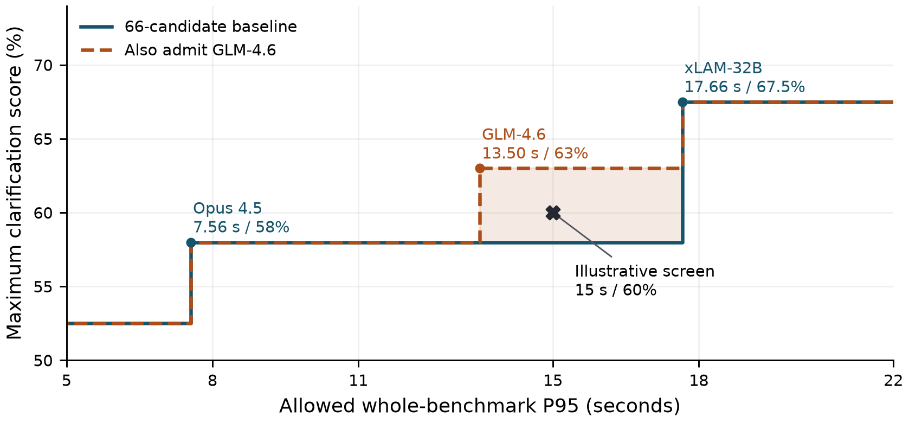

# Decision robustness audit

This audit tests whether the model shortlist changes when the eligibility rules change, and how much room the team has to set a stricter or looser clarification requirement. It uses the frozen BFCL snapshot and the [source audit](BFCL_GUIDE.md#8-eligibility-and-comparability-audit). The primary analysis remains the 66-configuration study.

## Candidate sets and feasibility

We cross two candidate-set assumptions. The first admits the single excluded GLM-4.6 (FC thinking) row flagged in the source audit. The second omits the two reviewed rows with zero scores on call-producing tasks and 100% irrelevance detection. Each scenario retains the recorded measurements, linear resource anchors, value functions, illustrative weights and original inclusive requirements. These are diagnostic scenarios. A general eligibility change would require decisions about all seven mode-label discrepancies, and the cause of the two zero-score patterns remains unresolved.

| Candidate set | Rows | Structured Pareto / feasible | Clarification Pareto / feasible |
| --- | ---: | ---: | ---: |
| Original suffix-based baseline | 66 | 30 / 14 | 22 / 0 |
| Also admit GLM-4.6 (FC thinking) | 67 | 31 / 15 | 23 / 1 |
| Omit the two flagged rows | 64 | 29 / 14 | 22 / 0 |
| Apply both changes | 65 | 30 / 15 | 23 / 1 |

The same criteria and all three unscreened profiles select the same winners in both workflows across the four scenarios. Gemini-2.5-Flash (FC) remains the best screened structured configuration under balanced weights. In both scenarios that include GLM-4.6, it is the only feasible clarification configuration. When the two flagged rows are omitted, Falcon3-1B-Instruct (FC) enters the clarification Pareto set and Llama-3.1-Nemotron-Ultra-253B-v1 (FC) leaves. The count therefore remains 22 with a change in membership. With both scenario changes, the structured count returns to 30 with GLM-4.6 in place of Nemotron-Ultra. The machine-readable outputs report all additions, removals, feasible candidates and maximizing sets.

## Exact clarification boundary

At a given benchmark P95 ceiling, take the largest clarification score among configurations with P95 at or below that ceiling, avoidance of at least 80%, and cost of at most USD 100. A proposed clarification floor is feasible at that ceiling exactly when it lies on or below the step in Figure 5. Each upward step starts at an observed P95 value. Both requirements are inclusive. If the filtered set is empty, the maximum is undefined.

In the 66-row baseline, a 15 s P95 ceiling permits up to 58% clarification. Retaining a 60% minimum first requires 17.66 s. When GLM-4.6 is admitted, the 15 s ceiling permits up to 63%, and the 60% minimum first becomes feasible at 13.50 s. This is a 5 percentage-point change in the maximum clarification score at 15 s, or a 4.16 s reduction in the minimum benchmark P95 ceiling at 60%. Omitting the two flagged rows leaves the corresponding step functions unchanged in these scenarios. The units and boundaries describe benchmark screening. Task-specific tail latency requires measurement in the target serving environment.

## What the weight grid can reveal

Across the original 1,771 weight vectors, including ties among Pareto candidates, 13 of 30 structured and 11 of 22 clarification Pareto candidates maximize an additive score at least once. These counts describe the enumerated grid. An individual candidate can be excluded by the geometry of a linear weighted sum even with continuous weights [1].

For clarification, GPT-4.1-2025-04-14 (FC) is Pareto efficient with 32.50% performance, 86.52% avoidance, USD 100.75 cost and 4.01 s P95. The exact arithmetic midpoint of Claude-Haiku-4-5-20251001 (FC) and Gemini-2.5-Flash-Lite (FC) has 33.75%, 88.805%, USD 10.89 and 2.41 s. That midpoint strictly improves each criterion. Under the baseline affine value functions, its additive value is the mean of the two configurations' values. For every nonnegative weight vector summing to one, at least one of the two actual configurations must therefore score higher than GPT-4.1. The midpoint serves as a mathematical proof about scoring. It is separate from the set of deployable configurations and from the hard screening calculation. The example explains why the Pareto analysis adds information beyond the weighted rankings. In the spirit of [2], the team can use these diagnostics to revisit specific eligibility or preference assumptions.

## Reproduction

After installing `requirements.txt`, run `python -m scripts.decision_robustness_audit` from the repository. The audit verifies the source hash through the baseline loader, cross-checks Pareto membership against pairwise comparisons, reconciles the baseline result files and tests both sides of each observed latency boundary. It writes [the scenario records](../results/decision_robustness_audit.json) and [the boundary figure](../figures/05_clarification_feasibility.png).

1. Das, I., and Dennis, J. E. (1997). A closer look at drawbacks of minimizing weighted sums of objectives for Pareto set generation in multicriteria optimization problems. *Structural Optimization*, 14, 63–69. [Publisher](https://link.springer.com/article/10.1007/BF01197559)
2. HM Treasury. (2024). Use of multi-criteria decision analysis in options appraisal of economic cases, step 5. [Green Book supplementary guidance](https://www.gov.uk/government/publications/green-book-supplementary-guidance-use-of-multi-criteria-decision-analysis/use-of-multi-criteria-decision-analysis-in-options-appraisal-of-economic-cases#step-5-conduct-sensitivity-analysis-on-initial-results)
