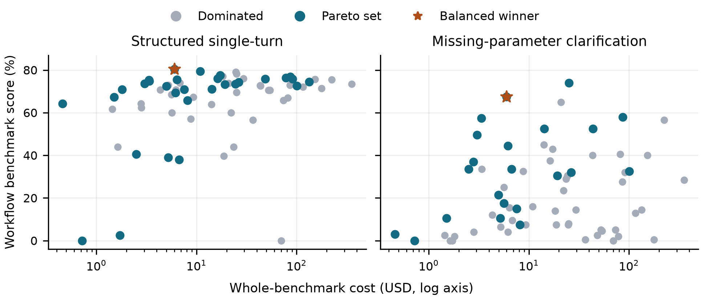
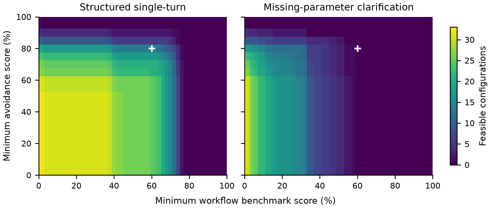
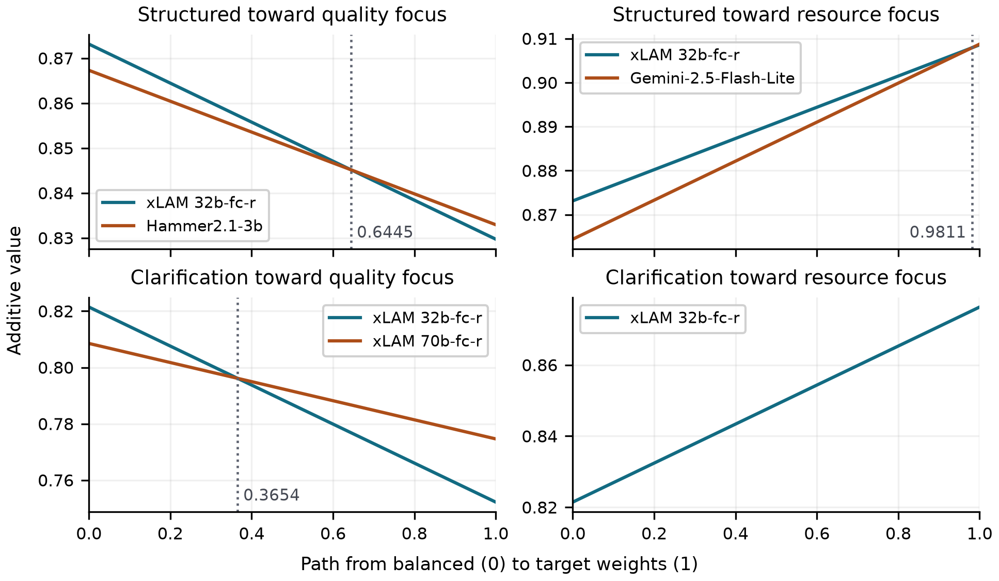
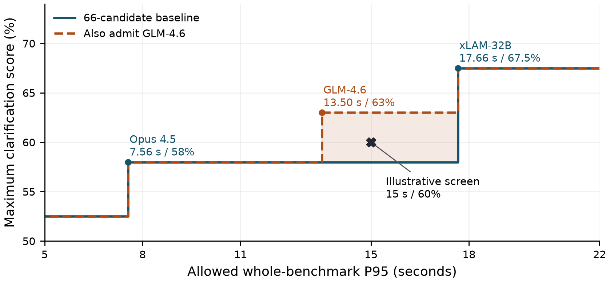

# Selecting AI Agent Models Through Normative and Constructive Decision Analysis

Ziling Yan, Xinrui Xu, and Jiaxin (Iris) Li

Cornell University, Ithaca, New York

## Abstract

We examine which model configurations a design team should shortlist for a proposed task-management agent that must either make a structured tool call from a complete request or clarify a missing required parameter. We used a frozen Berkeley Function-Calling Leaderboard snapshot and compared 66 configurations on workflow performance, irrelevant-call avoidance, reported whole-benchmark cost, and 95th-percentile latency. The workflows had 30 and 22 Pareto-efficient configurations. The illustrative screen admitted 14 structured configurations and zero clarification configurations. At a 15-second ceiling, the highest achievable clarification score rose from 58% to 63% when we admitted one excluded benchmark configuration in a sensitivity scenario. The three additive profiles kept their original winners in that scenario. Four of six illustrative selections changed under logarithmic resource value functions. In three individually confirmed clarification comparisons, two participants’ scores favored xLAM-2-32b-fc-r and one favored xLAM-2-70b-fc-r. No participant confirmed a numerical revision after review, and one requested direct evidence of task behavior before choosing. The case identifies which assumptions affect feasibility, ranking, and the evidence the team wants before choosing.

## 1. Decision context and question

A task-management agent can create a task immediately when a request supplies all required information. When a deadline is required and the request omits it, the agent should obtain it before saving the task. A request that calls for explanation alone should leave the task list untouched. These situations place different demands on model configurations. The decision in this project is which configurations to carry forward for each workflow and under which assumptions the shortlist changes. The three project members acted as the design team for this hypothetical case.

We use two lenses from decision aiding. First, we calculate how a choice follows from a declared set of configurations, goals, value functions, preferences, and requirements. Second, we examine what the design team learned when it reviewed those consequences, including which assumptions participants retained and what evidence they requested. Tsoukiàs distinguishes decision-aiding approaches by how the model of rationality is established [1]. In our case, the calculation provides a consistent conditional result, and the review supplies evidence about whether its framing is useful for the decision. The terms *a priori* and *a posteriori* refer to when preferences enter a particular comparison relative to seeing its trade-offs.

The alternatives are existing model configurations that could be taken forward for testing. The objectives are correct execution, restraint when a call is irrelevant, lower resource cost, and lower response-time burden. The intended use is an early shortlist for two tasks with different information requirements. An attractive choice therefore needs an explanation that connects the task, a measured consequence, and an assumption about what constitutes an acceptable trade-off. We evaluate each workflow separately so a strong result on straightforward calls does not obscure weak performance when a required detail is missing.

The study turns a broad benchmark into a decision the team can inspect. The same frozen measurements support three steps: identifying nondominated alternatives, comparing shortlists under explicit priorities, and finding the conditions that overturn a choice. The group then reviews those consequences and records the evidence it still needs. This sequence helps the team decide which configurations to test and which assumptions to revisit before committing that effort.

## 2. Data and decision criteria

Function calling is a model’s ability to select an available tool and supply structured arguments in response to a user request. The Berkeley Function-Calling Leaderboard (BFCL) evaluates this behavior across expert-written and user-contributed tasks, including tests for abstention and stateful interaction [2]. Its published V4 dataset supplies measured consequences for a common collection of configurations. We froze the CSV retrieved on October 21, 2026 Eastern time and verified its SHA-256. The snapshot has 109 configuration rows and 36 fields. A row represents a model in its recorded evaluation mode. The baseline retains 66 rows with a literal `(FC)` suffix, finite scores in the 0–100 range, and finite positive cost and P95 latency. All 43 exclusions come from the suffix test. The release code and frozen values supply the measurement definitions [3, 4].

**Table 1. BFCL measures used in each decision model**

| Criterion | BFCL field | Preferred direction | What the measurement represents |
| --- | --- | --- | --- |
| Structured performance | Non-Live Simple AST | Higher (%) | Accuracy of the function name and arguments in one call, checked by parsing its abstract syntax tree (AST) against accepted answers. |
| Clarification performance | Multi Turn Miss Param | Higher (%) | Fully correct conversations on simulated tools when the user omits a required parameter. Expected calls and system state are checked across turns. |
| Avoidance | Irrelevance Detection | Higher (%) | Success when none of the available tools applies, operationalized as the absence of a decodable call. |
| Cost | Total Cost ($) | Lower (USD) | Reported cost across the whole benchmark suite, based on API prices or an estimate of GPU time. |
| Latency | Latency 95th Percentile (s) | Lower (s) | The 95th percentile of recorded nonzero per-call times pooled across the benchmark suite. |

Each workflow uses one performance measure and the three shared measures. The headline BFCL Overall Accuracy combines tasks beyond the two workflows and already incorporates irrelevance detection. We excluded it from the additive model to avoid counting overlapping evidence twice. For illustration, the xLAM-2-32b-fc-r (FC) row shows 80.42% structured performance, 67.50% clarification performance, 80.23% avoidance, USD 6.00 benchmark cost, and 17.66 s benchmark P95. The different workflow scores represent performance on different tests. The resource measurements characterize the same full-suite run in both decision models.

That row illustrates the path from data to a decision. For a complete request, 80.42% is the workflow consequence. When the required deadline is missing, the same row contributes 67.50%. The other three entries stay fixed so the effect of switching the workflow is visible. The raw 17.66 s value also explains exactly why this candidate is excluded at the 15 s ceiling and exactly when it becomes feasible if that ceiling changes. Appendix A identifies the files that preserve each step.

The structured score averages three language subsets of unequal size in the evaluation release [4]. In the 200-conversation clarification category, the benchmark can require the model to ask for missing information before acting. A conversation passes only if every turn passes, including expected no-call turns and the subsequent comparison of execution results and system state. The avoidance score tests behavior when none of the supplied tools applies. These definitions matter for transfer to task management. A high structured score supports shortlisting for a single complete request, while the clarification score reflects a sequence of actions and abstentions under a different test. Cost and elapsed time for a specific production task would require workflow-level measurement.

## 3. Decision models

**Pareto filtering.** A configuration is dominated when another configuration is at least as good on all four criteria and strictly better on at least one. We enumerated all configurations exactly for each workflow, retaining identical consequence vectors when both were nondominated. This step identifies trade-offs without specifying a relative value for improvements on different criteria.

**Compensatory ranking.** Equation (1) gives the additive value of configuration x as the sum of its four criterion values multiplied by nonnegative weights that sum to one [5]. The percentage criteria were divided by 100. Cost and latency each used the decreasing linear function `(upper − observed)/(upper − lower)` with fixed anchors of USD 0.46–355.17 and 0.96–568.59 s, respectively.

**Equation 1.** V(x) = w₁v₁(x) + w₂v₂(x) + w₃v₃(x) + w₄v₄(x) (1)

The balanced, quality-focused, and resource-focused weight profiles were `(0.40, 0.20, 0.20, 0.20)`, `(0.60, 0.25, 0.075, 0.075)`, and `(0.25, 0.15, 0.35, 0.25)` in workflow, avoidance, cost, and latency order. These profiles were specified as illustrative scenarios. For structured xLAM-2-32b-fc-r, the balanced calculation is `0.40(0.8042) + 0.20(0.8023) + 0.20(349.17/354.71) + 0.20(550.93/567.63) = 0.873132`. The calculation uses full precision. Reported optimum sets include all candidates within an absolute value difference of 10⁻¹² of the maximum.

**Requirement screening.** A feasible configuration had to satisfy all four illustrative limits: workflow performance ≥60%, avoidance ≥80%, benchmark cost ≤USD 100, and P95 ≤15 s. We then ranked feasible candidates using balanced weights. The 15 s limit excludes xLAM-2-32b-fc-r in both workflows even though the row passes the other three requirements for both. Under the unscreened additive model, its performance and low reported cost can compensate for the higher latency.

For the public preference grid, we enumerated nonnegative four-criterion weights at 0.05 increments, retaining 1,771 weight vectors that sum to one per workflow. Each vector contributes once, divided evenly among Pareto-set maximizers if there is a tie. A dominated option can share an all-candidate optimum when it is worse only on criteria given zero weight. Computing shares within the Pareto set preserves the declared shortlist interpretation at those boundary vectors. The requirement grid separately varies the performance and avoidance floors and keeps the two resource limits fixed. These grids summarize the behavior of the models across chosen inputs.

Across the grid, 13 of the 30 structured Pareto configurations and 11 of the 22 clarification Pareto configurations maximize the score at least once. Those counts describe the grid resolution. One clarification example gives a stronger result [6]. GPT-4.1 (FC) is Pareto efficient at 32.50% clarification, 86.52% avoidance, USD 100.75 and 4.01 s. The exact midpoint of the Claude-Haiku-4.5 (FC) and Gemini-2.5-Flash-Lite (FC) consequence vectors improves every measure: 33.75%, 88.805%, USD 10.89 and 2.41 s. Under the affine value functions, the midpoint's weighted score is the average of those two configurations' scores. For any nonnegative weights summing to one at least one of them must therefore outrank GPT-4.1. The midpoint is a calculation about the unscreened ranking. Each point on the Pareto front remains an individual configuration.

Each method supports a different step of the decision. Pareto filtering identifies candidates for a trade-off discussion. The additive model orders candidates after a value model is specified. Screening implements the acceptability rule before any compensatory comparison. This sequence keeps two possible uses of latency visible: as a continuous preference in the additive model and as a limit in the scenario where the team treats responsiveness as mandatory. It also makes adding a requirement auditable. A change in the selected configuration can be traced to a candidate failing a particular floor or ceiling.

## 4. Shortlists and worked examples

**Table 2. Conditional selections from the 66-configuration baseline**

| Workflow | Pareto | Balanced | Quality-focused | Resource-focused | Feasible | Best feasible |
| --- | ---: | --- | --- | --- | ---: | --- |
| Structured | 30 | xLAM-2-32b-fc-r | Hammer2.1-3b | Gemini-2.5-Flash-Lite | 14 | Gemini-2.5-Flash |
| Clarification | 22 | xLAM-2-32b-fc-r | xLAM-2-70b-fc-r | xLAM-2-32b-fc-r | 0 | None in the baseline set |

All named configurations in Table 2 have the `(FC)` suffix. The two rightmost columns use the illustrative requirements and balanced ranking. Each reported optimum is unique under the specified tie tolerance. Figure 1 shows Pareto membership in a two-dimensional projection. The highlighted points were selected using dominance in four dimensions.

**Figure 1. Pareto membership for structured and clarification workflows.** The projections display workflow performance and reported benchmark cost on a logarithmic axis. Pareto membership uses all four criteria, including avoidance and P95 latency.

For structured calls, moving from balanced to resource-focused weights favors Gemini-2.5-Flash-Lite. Relative to xLAM-2-32b-fc-r, it gives up 9.50 percentage points of structured performance, gains 12.27 avoidance points, and lowers benchmark P95 from 17.66 to 1.67 s. It reports USD 1.55 higher benchmark cost. Its lead under the resource-focused weights is only 0.000168 on the additive scale. When the requirements are applied first, Gemini-2.5-Flash wins among the 14 feasible rows. Its structured and avoidance scores are 74.33% and 93.67%, with USD 26.36 benchmark cost and 5.62 s P95. This illustrates how requiring acceptability before ranking can change the choice.

For clarification, shifting from balanced to quality-focused weights moves the unscreened preference from xLAM-2-32b-fc-r to xLAM-2-70b-fc-r. The 70B configuration gains 6.50 clarification points (67.50% to 74.00%). It loses 1.12 avoidance points and adds USD 19.10 whole-benchmark cost and 73.55 s P95. Under the illustrative screen the 70B configuration fails avoidance and latency, while 32B fails latency. The screen produces an empty shortlist within the baseline set, which makes reevaluating the candidate rule or negotiating the requirements a decision in its own right.

Selecting by the dataset’s overall score would give a different starting point. Claude-Opus-4-5-20251101 (FC) leads the retained set on Overall Accuracy at 77.47%, but its clarification score is 58.00%. It meets the other three illustrative limits and falls 2.00 points short on clarification. The workflow-specific fields reveal a shortfall that the headline score alone cannot identify.

### Practical task examples

Consider a hypothetical `create_task(title, list_id, due_at)` tool. All three arguments are required for the submission list, including a deadline with a UTC offset. Table 3 connects each criterion to a behavior the design team could inspect in a later task test. These examples stipulate expected behavior for the proposed agent. The measured rankings come from BFCL tasks.

**Table 3. Hypothetical task requests and the behavior a task test should check**

| Request | Expected action | What to inspect |
| --- | --- | --- |
| Create “Submit draft” in `course-project`, due November 10, 2026 at 5 p.m. New York time. | Make one call using the stated title and list and the deadline `2026-11-10T17:00:00-05:00`. | Correct function, arguments, offset, and resulting task record. |
| Create “Submit draft” in `course-project`. | Ask for the due date, time, and time zone. After the answer, make one call and confirm the saved task. | No premature write, correct use of the reply, and acknowledgement after the write. |
| Explain what a Pareto frontier means. | Provide a textual explanation. | The task list is untouched and there is no tool call. |

The cases also illustrate a decision about requirements. Saving a routine reminder without a deadline can be acceptable if the list allows it. Saving a submission task before the due date is supplied can violate the stated schema. The evaluation must identify which rule applies before treating an absent field as a failure to clarify. Beyond correct argument structure, a task test would need to inspect the resulting write and the assistant's acknowledgement. Those checks give an operational meaning to the team's request for stronger evidence.

The requirement grid in Figure 2 varies the workflow and avoidance floors, with the whole-benchmark cost and P95 ceilings held at USD 100 and 15 s. It shows what happens when two quality requirements change together. A single grid cell depends on both floors and the two fixed limits. Changing the P95 limit requires the separate raw-consequence calculation in Section 5.

**Figure 2. Feasible-set size across illustrative requirement pairs.** The color scale shows how many configurations meet both displayed score floors and both fixed resource limits within the 66-row baseline. The cross marks the 60% workflow and 80% avoidance floors used in the main screen.

## 5. Robustness of the selections

We first changed the form of both resource value functions to `ln(upper/observed)/ln(upper/lower)`, holding candidates, anchors, score values, and numeric weights fixed. The logarithmic function places greater value per unit on improvements at the low-resource end. Four of the six workflow–profile winners changed, while the 30/22 Pareto sets were preserved because the transformations are strictly monotone. The new resource-focused clarification winner, Qwen3-0.6B (FC), achieved 3% clarification accuracy with the lowest reported benchmark cost (USD 0.46) and lowest P95 (0.96 s). It falls below the 60% clarification requirement. This result shows what the compensatory model rewards when low resource consumption has high value.

We then omitted the maximum-cost observation, the maximum-latency observation, and their union. All six selections held when the value functions retained the original anchors. Recomputing the anchors after omitting the maximum-cost row, alone or jointly with the maximum-latency row, moved the structured resource-focused selection from Gemini-2.5-Flash-Lite to Command A Reasoning (FC). Both experiments removed the same alternatives in their respective fixed-anchor and reanchored versions. The difference in their winners came from changing the value scales.

We interpolated the four weights together along paths from the balanced profile to the quality- and resource-focused profiles (Figure 3). Along the clarification quality path, xLAM-2-32b-fc-r and xLAM-2-70b-fc-r tie at approximately 36.54% of the way from balanced to quality-focused. The latter leads for the remainder of that path. The structured resource-focused switch occurs at 98.11% of the way from balanced to resource-focused, consistent with its small endpoint margin. These fractions describe the two stated paths through weight space.

**Figure 3. Selection switches along four paths in weight space.** Each path holds candidate consequences and value functions fixed. At a switch, the two configurations shown tie at the unrounded crossing. Configurations that never attain the maximum are omitted from the figure.

With the other clarification requirements fixed, raising the P95 ceiling from 15 to 17.66 s first admits xLAM-2-32b-fc-r. Lowering only the clarification floor from 60% to 58% first admits Claude-Opus-4-5-20251101 (FC). There is no feasible row under a relaxation of avoidance alone or cost alone. These raw-consequence boundaries identify what the team would have to trade: a 2.66 s increase in the benchmark P95 ceiling or a 2.00-point reduction in the clarification floor, while keeping the remaining limits fixed.

### Joint requirements and candidate eligibility

We cross two changes to candidate eligibility: admitting the single excluded GLM-4.6 (FC thinking) row and omitting the two flagged rows that scored zero on call-producing categories and 100% on irrelevance detection. Both are diagnostic changes based on the source audit. We hold measurements, scale anchors, weights and the four screen limits fixed so changes can be attributed to the candidate set.

**Table 4. Candidate-set sensitivity of Pareto membership and feasibility**

| Scenario | Rows | Structured Pareto / feasible | Clarification Pareto / feasible |
| --- | ---: | ---: | ---: |
| Original baseline | 66 | 30 / 14 | 22 / 0 |
| Also admit GLM-4.6 | 67 | 31 / 15 | 23 / 1 |
| Omit two flagged rows | 64 | 29 / 14 | 22 / 0 |
| Apply both changes | 65 | 30 / 15 | 23 / 1 |

The original three profiles keep their unscreened winners across all four scenarios. The screened structured choice also stays Gemini-2.5-Flash. GLM-4.6 becomes the only feasible clarification configuration whenever it is admitted. Omitting the two flagged rows replaces Nemotron-Ultra with Falcon3-1B in the clarification Pareto set, which still has 22 members. The unchanged count conceals the change in membership.

**Figure 4. Maximum achievable clarification score by allowed benchmark P95.** Avoidance ≥80% and cost ≤USD 100 are fixed. A proposed floor and ceiling are feasible on or below the applicable step. The shaded region shows the extra feasible threshold pairs in the GLM scenario within the displayed range.

Figure 4 shows the exact boundary from observed model rows. A ceiling of 15 s permits 58% clarification in the baseline and 63% with GLM admitted. At a 60% floor, the first feasible ceiling changes from 17.66 to 13.50 s, a difference of 4.16 s. Omitting the two flagged rows leaves these boundaries intact within each eligibility scenario. The decision at the original requirements therefore depends directly on the definition of a candidate, even when the weighted winners stay stable. The source labels and measurements do not resolve whether the GLM configuration qualifies for the team's intended setting.

## 6. Team preference review

Each participant confirmed an individual clarification ranking on the original 66 candidates and fixed linear scales. The participants provided swing ratings over the stated ranges. We divided each rating by the sum of that person’s ratings to obtain their weights. Three cutoff decisions remained open and participants specified no benchmark-cost cap, so we calculated rankings without a screen. Prior exposure to project results varied, and some confirmation and exposure details were reported retrospectively. The evidence concerns what participants specified and retained in their individual comparisons.

**Table 5. Confirmed clarification comparisons and review outcomes**

| Reviewer | Swing ratings in criterion order | First and second by additive value | Recorded review outcome |
| --- | --- | --- | --- |
| 1 | 100 / 90 / 20 / 30 | 70B (0.787666), then 32B (0.785467) | Retained the recorded numerical case and deferred the model choice pending task behavior evidence. |
| 2 | 100 / 90 / 30 / 60 | 32B (0.812404), then 70B (0.798483) | Retained initial settings and was uncertain which trade-off mattered most. |
| 3 | 100 / 70 / 50 / 80 | 32B (0.835088), then 70B (0.810614) | Retained initial settings and judged the 70B clarification gain too small given its avoidance and resource trade-offs. |

The table abbreviates xLAM-2-32b-fc-r (FC) and xLAM-2-70b-fc-r (FC). Values compare alternatives within each participant’s model. No participant confirmed a replacement input, and the record contains no joint group recommendation. Participant 1 asked to observe whether the assistant requests the missing deadline, saves the supplied detail, and confirms completion before making a choice. The distinction between a routine reminder with an optional deadline and a submission task with a required deadline also emerged in the initial responses. That distinction changes how a task-specific evaluation defines a correct clarification. The constructive contribution is the documented shift in the evidence needed for a decision, alongside the retention of the numerical specifications [1].

The contrast matters for preference timing. The public profiles provide a common set of inputs that can be declared before ranking, while a Pareto-first discussion exposes the range of measured trade-offs before a participant evaluates them. The personal input cards were fixed for their designated computations. The post-comparison responses then addressed what each participant would retain, reconsider, or require evidence about. Participants' exposure to earlier exploratory results limits the claim that this sequence independently elicited initial preferences. The review demonstrates how the calculation and the decision conversation can be documented together within one small design team.

We used the reviewer's request to define a practical check for the next evaluation. The check observes when the agent asks for clarification, what it tries to write, what is actually saved, and whether the confirmation accurately describes the saved task. Appendix B reports a follow-up using the three-field tool contract and locally available Qwen configurations. It supplies observations of the task behavior, separate from the BFCL comparison of the xLAM configurations.

## 7. Assumptions and limits on conclusions

**Candidate eligibility changes feasibility.** The literal `(FC)` suffix disagrees with the release configuration flag for seven rows in the source audit. The excluded GLM-4.6 (FC thinking) reports clarification 63.00%, avoidance 84.96%, cost USD 4.64, and P95 13.50 s. These values clear all four clarification thresholds. Including this one configuration would make the screen nonempty. The baseline keeps a reproducible naming rule while the mode definitions are reviewed.

**Avoidance and resource proxies require interpretation.** In the BFCL release, an output with no decodable call passes an irrelevance item. Two eligible rows scored zero on all call-producing categories and 100% on irrelevance. One appears in both Pareto sets and the other supplies the upper latency anchor. The pattern raises a measurement-validity question whose cause is unresolved. Benchmark cost uses API pricing for 27 retained rows and a GPU-time estimate for 39. For locally hosted configurations, the estimate depends mechanically on recorded latency, so the two resource criteria can partially reward the same behavior. Endpoints, licenses, serving environments, per-task costs, and tail latency would need verification for any actual deployment.

**The preference model is conditional.** Additive ranking assumes that trade-offs can be represented by separate value functions over the chosen ranges. Its compensatory structure can give a high overall value to a configuration with low performance on a criterion. The illustrated limits express a different acceptability rule and were not jointly endorsed. The 1,771 enumerated weight vectors and 1,071 requirement pairs per workflow describe coverage of chosen grids. Selection shares depend on the discretization and Pareto-first tie policy. The snapshot compares configurations under benchmark conditions, and provides no repeated-run estimate of task performance or uncertainty. The three group judgments illustrate this design team's review and have limited transfer beyond the case.

## 8. Conclusion and contributions

For structured calls, xLAM-2-32b-fc-r leads under the balanced baseline, and Gemini-2.5-Flash leads under the same weights after the illustrative screen. For clarification, xLAM-2-32b-fc-r and xLAM-2-70b-fc-r represent a trade-off between workflow performance and avoidance and resource consequences. The zero-feasible result applies to the baseline candidate definition, and the GLM-4.6 observation makes that restriction consequential. The design team’s review identifies evidence needed for a further choice, especially correct clarification, persistence, and acknowledgement on the intended task. Together, these results support conditional shortlisting and make both the next measurement and the remaining value judgments explicit.

Under the illustrative screen, Gemini-2.5-Flash is the first structured configuration to verify on the intended task. For clarification, a team holding to all four limits should first resolve whether the excluded GLM-4.6 evaluation mode qualifies. Within the current 66 candidates, a team retaining the 60% floor could evaluate xLAM-2-32b-fc-r under a higher latency ceiling. A team retaining the 15 s ceiling could evaluate Claude-Opus-4-5-20251101 only if 58% clarification performance is acceptable. For any shortlisted model, the next confirmation step is to verify the tool call and saved state on matched requests and measure elapsed time in the target serving setup. Those decisions follow from the same consequence matrix and make the value of collecting task-specific data explicit.

Ziling Yan audited benchmark provenance, definitions, eligibility, and proxy comparability. Xinrui Xu independently verified the baseline decision models and developed the worked cases. Jiaxin (Iris) Li ran the scale, anchor, preference, and requirement sensitivity analyses and consolidated the individual preference-review evidence. All three supplied individual judgments.

## References

1. Tsoukiàs, A. (2008). From decision theory to decision aiding methodology. *European Journal of Operational Research*, 187(1), 138–161. [Publisher record](https://www.sciencedirect.com/science/article/abs/pii/S0377221707002949)
2. Patil, S. G., Mao, H., Yan, F., Ji, C. C.-J., Suresh, V., Stoica, I., and Gonzalez, J. E. (2025). The Berkeley Function Calling Leaderboard (BFCL): From tool use to agentic evaluation of large language models. *Proceedings of the 42nd International Conference on Machine Learning*, PMLR 267, 48371–48392. [Proceedings](https://proceedings.mlr.press/v267/patil25a.html)
3. UC Berkeley. *Berkeley Function-Calling Leaderboard V4*. Project data snapshot retrieved October 21, 2026 Eastern time. [Leaderboard](https://gorilla.cs.berkeley.edu/leaderboard)
4. BFCL evaluation release `bfcl-eval==2025.12.17`. [Release and source distribution](https://pypi.org/project/bfcl-eval/2025.12.17/)
5. Government Analysis Function. (2024). *An introductory guide to multi-criteria decision analysis*. [Guidance](https://analysisfunction.civilservice.gov.uk/policy-store/an-introductory-guide-to-mcda/)
6. Das, I., and Dennis, J. E. (1997). A closer look at drawbacks of minimizing weighted sums of objectives for Pareto set generation in multicriteria optimization problems. *Structural Optimization*, 14, 63–69. [Publisher](https://link.springer.com/article/10.1007/BF01197559)

## Appendix A Reproducibility

The public project repository preserves the path from evidence to choice. The [frozen source CSV](https://github.com/irisli0926/cee5980-ai-model-selection/blob/f849e698b606497abbee91b60401aa744a31e55d/data/bfcl_snapshot_2026-10-21.csv) contains the source measurements. Its manifest records the SHA-256 digest. The [eligibility audit](https://github.com/irisli0926/cee5980-ai-model-selection/blob/f849e698b606497abbee91b60401aa744a31e55d/results/eligibility_audit.csv) records why each source row was retained or excluded. The structured and clarification consequence-and-ranking files show the four raw consequences, Pareto membership, and calculated values. The requirement and switching-path files record which changes in assumptions admit a candidate or reverse an optimum. [Integrated analysis and data](https://github.com/irisli0926/cee5980-ai-model-selection/tree/f849e698b606497abbee91b60401aa744a31e55d)

Install the declared Python dependencies and run `python analysis.py`, `python sensitivity.py`, and `python scripts/verify_baseline.py` from the repository. The independent verifier reconstructs eligibility, consequences, Pareto membership, ranks and ties, and both grids. The sensitivity test suite covers tied switch boundaries, omitted extreme observations, logarithmic endpoints, and exact single-requirement feasibility boundaries. The baseline notebook can also be executed end to end.

The candidate-set and joint-requirement analysis runs with `python -m scripts.decision_robustness_audit`. Its JSON records the Pareto members and feasible candidates in each scenario, weight-grid coverage, and every breakpoint in the clarification boundary. Figure 4 uses a focused viewing window. Table 5 summarizes the individual confirmations. Their underlying records remain with the project team. [Robustness audit code and results](https://github.com/irisli0926/cee5980-ai-model-selection/pull/10)

## Appendix B Local task behavior check

To exercise the reviewer's proposed evaluation, we ran six synthetic cases on three locally installed Qwen configurations. Two cases provided a complete task request, two omitted a required deadline, and two asked a question unrelated to task creation. The complete and missing-deadline requests identified the list by its explicit ID. The tool used the `create_task(title, list_id, due_at)` contract from Table 3. Each trial used an independent in-memory SQLite store so the evaluator could inspect the resulting record directly. The BFCL CSV provides the consequences used for shortlisting. The SQLite store records task behavior under this separate test.

A complete case passed when exactly one valid tool call produced the expected row and the assistant confirmed it without an extra call. A clarification case also required the assistant to ask for the deadline before attempting the write. The evaluator then supplied the deadline. Expected timestamps were compared as absolute instants and required explicit offsets. For unrelated requests, the outcome measures tool abstention through a visible response, an empty tool-call log, and an empty task store.

**Table 6. Local workflow behavior across six fixed cases per configuration**

| Local configuration | Quantization | Complete request | Missing deadline | No-tool request |
| --- | --- | ---: | ---: | ---: |
| `qwen3.5:2b` | MXFP8 | 1/2 | 1/2 | 2/2 |
| `qwen3.5:9b` | NVFP4 | 2/2 | 2/2 | 2/2 |
| `qwen3.8:27b` | NVFP4 | 2/2 | 2/2 | 2/2 |

The 2B configuration produced two distinct attempts that the test sink blocked. In the complete case it attempted 14:15 at UTC−05:00 for a deadline of 09:15 at UTC−05:00, a five-hour shift with the same offset. In a missing-deadline case it immediately supplied an unrequested date. The other two configurations completed both kinds of task, including the confirmation after a verified save. All three left the store empty in both unrelated cases. The observed failures distinguish deadline normalization from deciding when the user must supply a value. A later test of shortlisted configurations should include both checks and inspect the actual stored record.

The runs used the local Ollama 0.40.16 API and MLX runner with temperature 0, seed 42, a 4,096-token context, a 768-token output cap, and thinking disabled in the requests. Each fixture was run once per configuration in the reported check, which followed a pilot that exposed ambiguity about the list ID and a punctuation-dependent clarification gate. The revised fixtures and gate applied to all three configurations. Results describe the observed combinations of model, quantization, serving setup, and task. The two xLAM configurations remain benchmark-based candidates for their own task check.
